# DM41_Explorer

A Windows, MacOS, and Linux desktop GUI for reading, writing, and editing the
memory of a [DM41L/X](https://www.swissmicros.com/) (HP‑41CX emulator) over its
serial console or USB disk interface.

## Features

- **Live or offline** — connect directly to a DM41L over USB serial, or work
  offline from a saved `.dm41` or `.d41` state file (File > Open State / Save
  State, with the last ten files under File > Open Recent).
- **Overview** — a quick summary of the DM41L/X's memory, including the stack
  and alpha registers, main memory, and extended memory. Also shows the
  current values of R00, .END., ΣREG, and a memory-usage summary at a glance.
- **Flags** — all 56 status flags, named and editable.
- **Programs** — list, import, export, and remove programs from the
  calculator's memory.
- **Key Assignments** — view, add, edit, and remove user key assignments,
  including any XROM function, by name or by its module and function
  numbers, and save a printable PDF diagram of the keyboard.
- **Alarms** — list, add, edit, and remove the calculator's alarms (message,
  control, and conditional), with past-due alarms marked.
- **Data Registers** — browse and edit the user memory registers as numbers,
  text, or raw hex.
- **XM Files** — list, add, edit, and remove files stored in extended memory
  (Data, ASCII, and Program types).
- **Hex View** — a full, color-coded map of the entire memory space (status
  registers, extended memory, program memory, data memory, and unused space).
- **XROM libraries** — names for the functions of the DM41X's application
  pacs (Math, Stat, Advantage, PPC and the rest) and of any other ROM you add
  as a `.mod` file or an hp41uc XROM list (Tools > XROM Libraries).
- **Pack Memory** (Tools menu) — reclaims unused registers the way the
  calculator's PACK does.
- **FOCAL Mnemonics Reference** (Help menu) — every instruction name that
  importing a TXT program and the key assignment dialog accept, with the
  trigraph tables.

## Requirements

- Python 3.10 or later (tested with 3.12 and 3.14).
- A DM41L connected over USB, if you want to talk to real hardware —
  otherwise you only need a `.dm41` or `.d41` state file to explore.

## Using DM41_Explorer

DM41_Explorer works in one of two ways: connected over USB serial (for the
DM41L), or disk-based (for the DM41X, or for editing saved state files).

### Connecting to a DM41L

A serial connection is necessary only for data transfer to or from the DM41L.
To configure the device for connectivity, power the calculator off and then
press and release the “ON” and “C” keys simultaneously to enable the serial
console.

Once the calculator is set to SERIAL CONSOLE mode and a USB connection is
established with your computer, make sure DM41_Explorer is in **DM41L mode**
(Preferences → General → Calculator model; the status bar shows the current
one), then choose “Connect / Reconnect…” from the “Connect” menu (Ctrl+K or
Cmd+K on macOS). A dialog box resembling the following will be displayed:

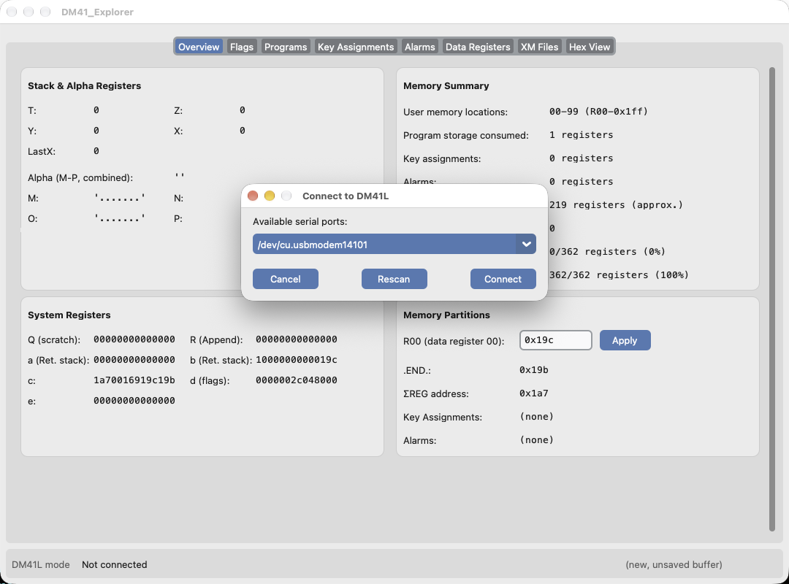

Choose the appropriate serial port and press the Connect button. If no state
has been opened or changed, DM41_Explorer then reads the calculator's memory
and shows it in the Overview tab. To read it again later, choose “Get State
from DM41L” from the Connect menu.

#### Which serial port do I use?

If you are unsure which serial port to select, follow these steps to identify
the correct one:

1. Disconnect the calculator.
2. Click the "Rescan" button.
3. Note the available serial ports.
4. Reconnect the calculator.
5. Click "Rescan" again.
6. Identify the newly listed serial port.

Once a successful connection is established, DM41_Explorer will automatically
save and preselect this port for future sessions.

### Working in Disk-Based Mode

The DM41X uses a disk-based USB interface and supports the storage of multiple
state files. To generate a state file on the DM41X, press SETUP, select “File,”
and choose “Save DM41 state file.” This procedure must be completed before
DM41_Explorer can load the calculator’s state.  

Once a state file is stored on the device, connect the DM41X to your computer,
press CST, and select “USB Disk” from the calculator menu; the unit will appear
as a removable drive.  

To load a state file into DM41_Explorer, select “Open State…” from the “File”
menu; “Open Recent” lists the last ten state files you opened or saved. To
transfer a state file back to the calculator, use the “Save State” command.
Eject the disk from the computer when you are finished.

The DM41X can store multiple state files. To load a particular state file onto
the calculator, eject the device from the computer, press SETUP, select “File,”
and choose “Load DM41 State File.”  

Additionally, the “File” menu may be used to load and save state files from
other directories on your computer.

## The Tabs

### Overview Tab

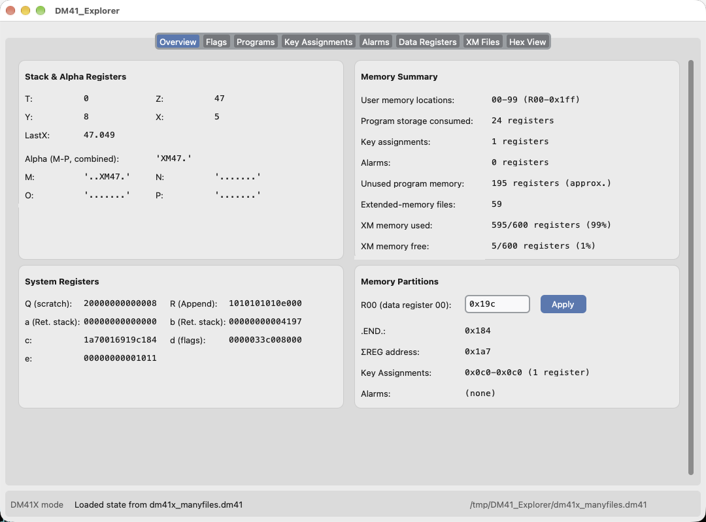

The Overview tab shows a quick summary of the loaded memory state. It is
almost entirely read-only, except for the address of
the R00 register, which you can adjust if you want to experiment with synthetic
programming.

### Flags Tab

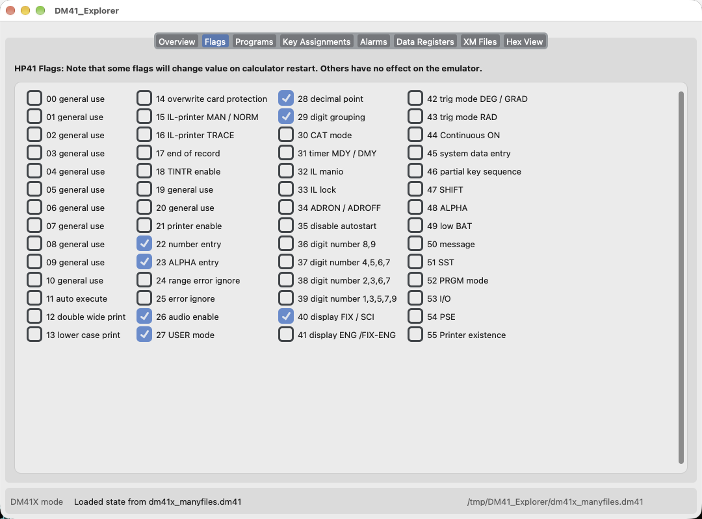

A complete list of all the user and system flags and their current values.
Some of the flags are available for use by HP41 applications, some control
system behavior, and others pertain to peripherals and will have no effect on
the DM41L. Some flags are automatically reset each time the calculator is
turned on.

### Programs Tab

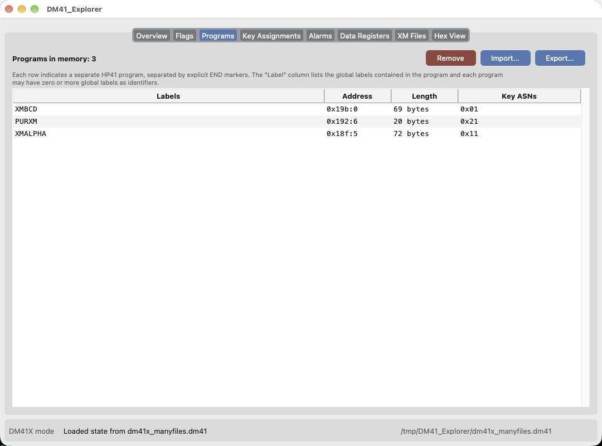 

The Programs tab lists the programs currently loaded into the program
memory portion of the loaded state file. From this view you can export and
remove loaded programs, and import new ones. Programs can be imported or
exported in RAW, TXT, or DAT format. DM41_Explorer also supports "PPC" format
which is the same as DAT format but with line breaks. RAW files are read with
or without hp41uc's checksum trailer; exported RAW files have one unless you
turn it off in Preferences → General. A file to import can hold
several programs, each ending with its own END; they are all imported, in the
order they appear in the file. If an imported program has the same global
label as one already in memory, DM41_Explorer lists what would be replaced and
asks first; the old program is removed, and its key assignments move to the
new program's labels of the same name. To export several programs into one file,
Shift- or Cmd/Ctrl-click to select their rows before choosing Export.

### Key Assignments Tab

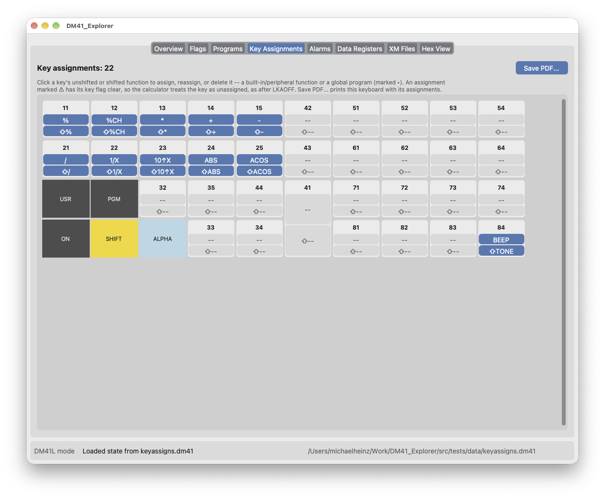

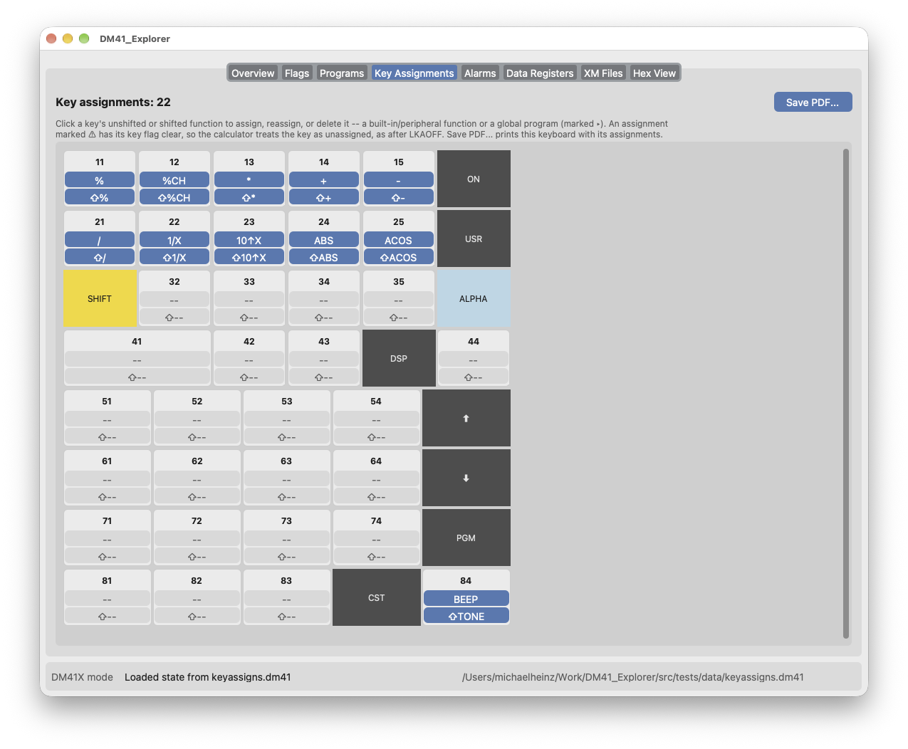

The Key Assignments tab allows you to view and edit the user key assignments in
the loaded state. It shows the keyboard of the model DM41_Explorer is working
as (see [Calculator model](#calculator-model)): the DM41L's four rows of ten
keys in DM41L mode, the classic HP-41 keyboard in DM41X mode. Each key has a
button for its unshifted assignment and one for its shifted assignment;
clicking either lets you edit it. You can choose:

- **Function:** a built-in function, or one from an active [XROM
  library](#xrom-libraries), by picking it or typing its name. A typed name
  is looked up the way `ASN` does it on the calculator, so with the Standard
  Applications Pac active, `LOG` is the pac's LOG. When two functions share
  a name, the list shows where each comes from. You can also type
  `XROM 26,38` or `XROM "LOG"`.
- **XROM:** any XROM function by its module (1–31) and function (0–63)
  numbers, whether or not a library names it. A function a DM41L doesn't
  have can still be assigned in DM41L mode, after a confirmation.
- **Program:** one of the currently loaded programs.
- **Raw Hex:** two hexadecimal bytes, if you want to experiment with
  synthetic programming.

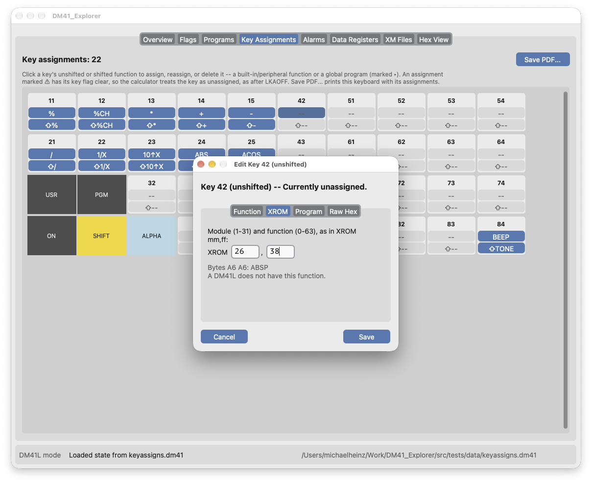

**Save PDF…** (or Cmd/Ctrl+E) saves a printable diagram of the keyboard,
titled with the state's name, with every assignment on its key: shifted
assignments on a gold strip across the top of the key, unshifted ones below.
Global programs are marked with ▸, and an assignment whose key flag is clear
(as after `LKAOFF`) has a dashed outline. A list of all the assignments
follows on a second page.

### Alarms Tab

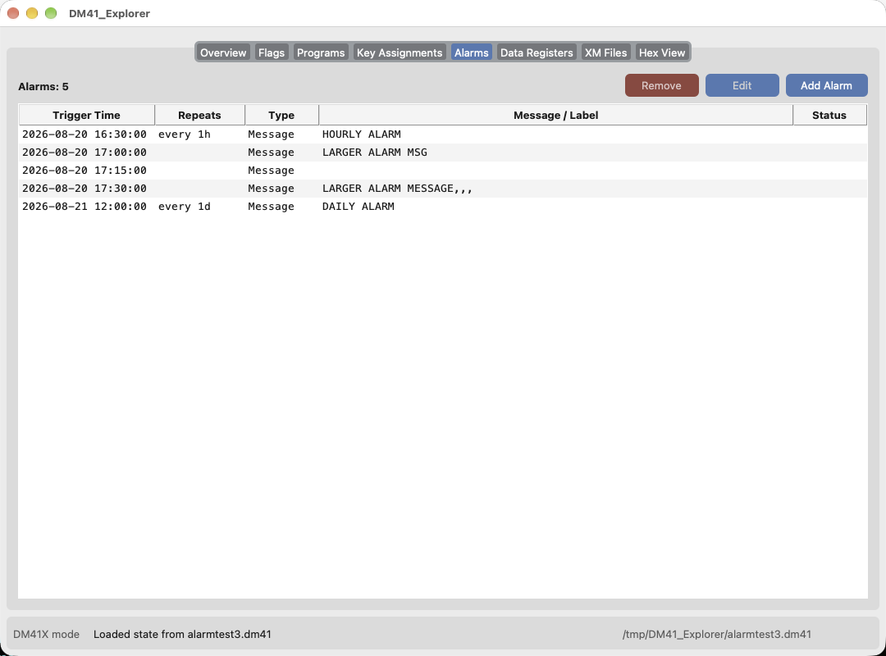

The Alarms tab lists the alarms in the loaded state in the order they will go
off, with each one's trigger time, repeat interval, type, and message or
program label. An alarm marked past due in the Status column won't go off by
itself until it is reactivated on the calculator (see the HP-41CX Owner's
Manual).

An alarm is one of three types:

- **Message:** shows a message of up to 24 characters.
- **Control:** runs the program at a global label of up to 22 characters. With
  no label, it resumes the program from its current line.
- **Conditional:** like Control, but runs the program only if the calculator
  is off when the alarm goes off.

#### Adding an alarm

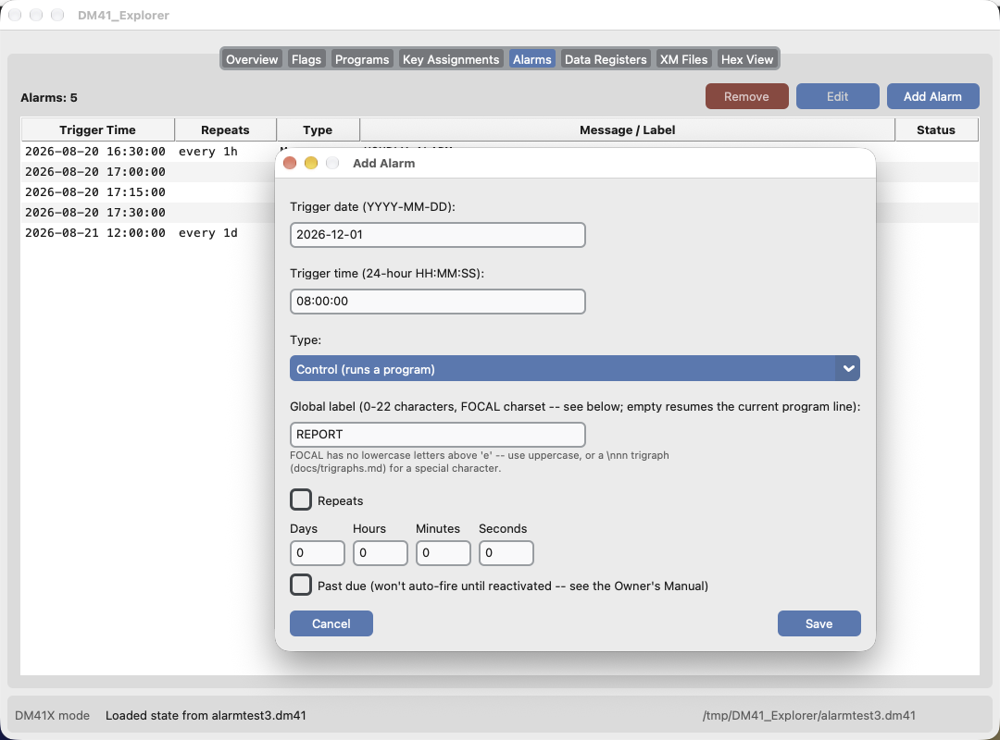

Click **Add Alarm** and fill in:

- **Trigger date** as YYYY-MM-DD and **trigger time** as 24-hour HH:MM:SS.
- **Type**, then the **message** or **global label** it asks for. These use
  the calculator's character set: it has no lowercase letters above `e`, so
  use uppercase, or a trigraph such as `\nnn` for a special character (see
  [docs/trigraphs.md](docs/trigraphs.md)).
- **Repeats**, if the alarm should go off again, with the interval in days,
  hours, minutes, and seconds.
- **Past due**, to store the alarm already past due.

Click **Save**. The alarm takes its place in the list by trigger time. If it
can't be stored, for instance because memory is full or the message is too
long, DM41_Explorer says why and leaves the alarms as they were. The same
applies when you edit an alarm.

#### Editing and removing an alarm

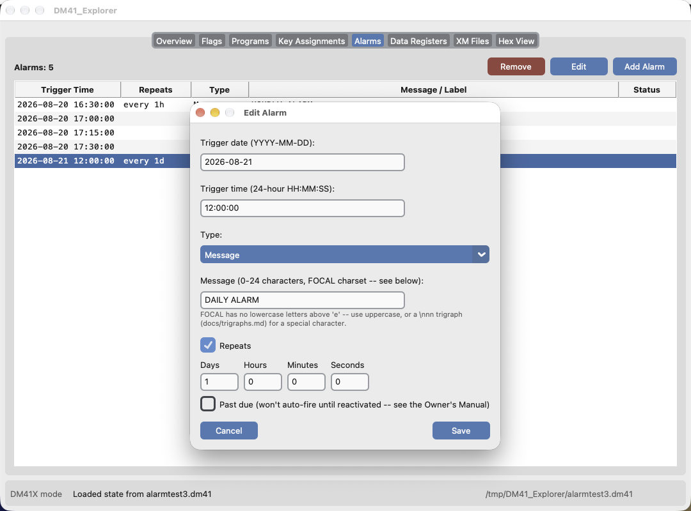

Select an alarm and click **Edit**, or double-click it, to open the same
dialog filled in with that alarm's settings. Change what you need and click
**Save**. To delete an alarm, select it and click **Remove**; DM41_Explorer
asks you to confirm first.

### Data Registers Tab

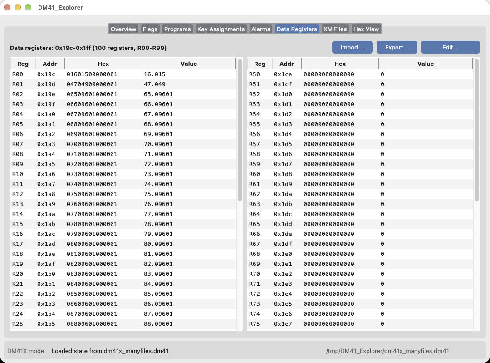

The Data Registers view shows the contents of user memory, and allows you to
import, export, and alter portions of it. It's broken into two halves (to make
better use of space) and you can enter BCD, ASCII, or hexadecimal data into any
register. Select a register with the mouse, then click on the desired action.

### XM Files Tab

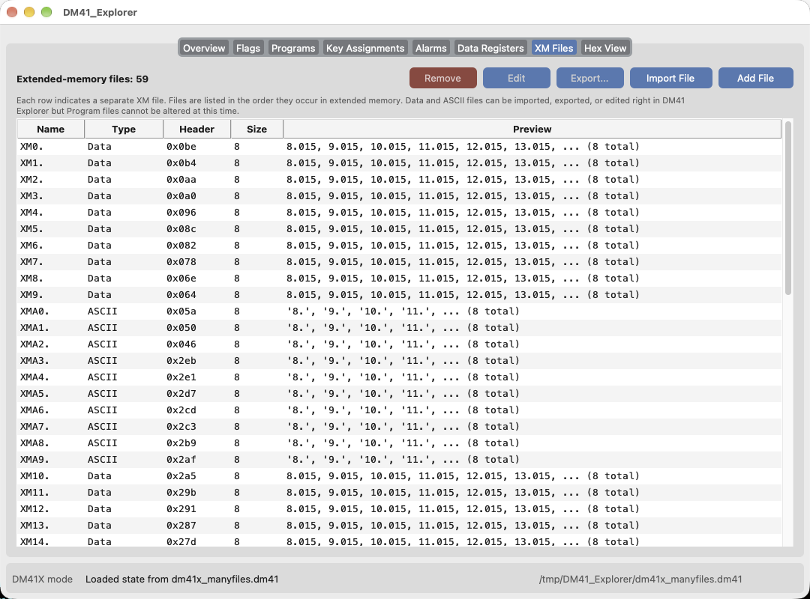

The XM Files view is organized similarly to the Data Registers view, and allows
you to import, export, and alter files in Extended Memory. Unlike the Data
Registers view, there is no raw hex entry: a Data file holds numbers and an
ASCII file holds text. Program files can be viewed and removed, but not
created or edited.

### Hex View Tab

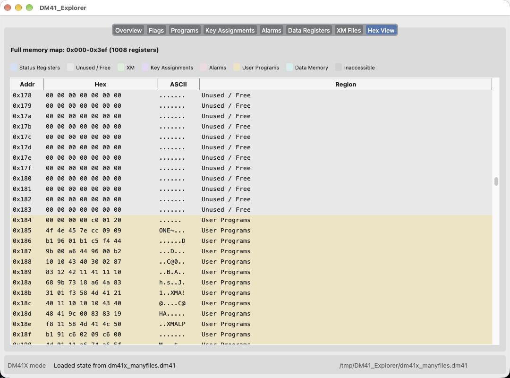

The Hex view shows the raw contents of calculator memory, color-coded by the
region. It is useful for studying how HP41 memory is organized.

## Tools and Help Menus

- **Tools > Pack Memory…** packs program memory, key assignments, and alarms
  the way the calculator's PACK does, and reports how many registers it
  reclaimed. Packing before an import makes the most room available.
- **Tools > XROM Libraries…** — see [XROM Libraries](#xrom-libraries)
  below.
- **Help > FOCAL Mnemonics Reference** lists every instruction's name, the
  other spellings that importing a TXT program and the key assignment dialog
  accept, and the character-substitution and trigraph tables. It can stay
  open while you work.
- **Help > Keyboard Shortcuts** lists the [keyboard
  shortcuts](#keyboard-shortcuts).

### XROM Libraries

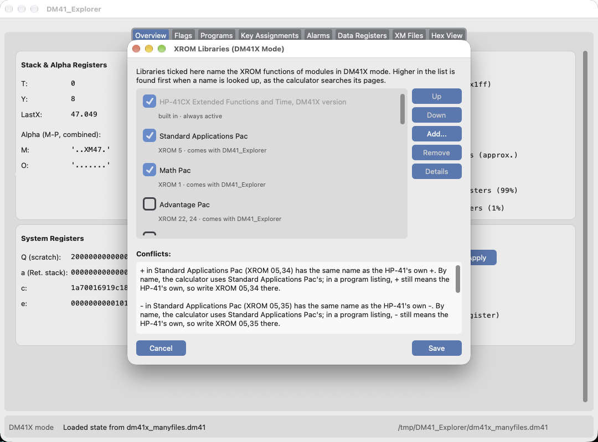

An XROM instruction stores only a module and function number; its name
comes from the ROM it calls. DM41_Explorer knows the built-in ROMs of each
model, and **Tools > XROM Libraries** lets you turn on names for others:
the 20 application pacs on the DM41X's disk and the Thermal Printer come
with DM41_Explorer, and **Add…** imports any other ROM from a `.mod` file,
an hp41uc XROM list or a library file. Tick the libraries you use and put
them in the order of the calculator's ROM pages. A conflict panel shows
where they clash, for instance two pacs that share an XROM number. Each
mode keeps its own list.

See [docs/xrom_libraries.md](docs/xrom_libraries.md) for how names are
looked up, what the conflict messages mean and the library file format.

## Keyboard Shortcuts

DM41_Explorer is menu-driven, and every shortcut below mirrors a menu item (or,
for Export/Import, a tab's header button). `Ctrl` is used on Windows and Linux;
macOS uses `Cmd` for the same shortcuts.

| Action | Windows / Linux | macOS |
| --- | --- | --- |
| New Memory Buffer | Ctrl+N | Cmd+N |
| Open State... | Ctrl+O | Cmd+O |
| Save State | Ctrl+S | Cmd+S |
| Save State As... | Ctrl+Shift+S | Cmd+Shift+S |
| Preferences | Ctrl+, | Cmd+, |
| Quit | Ctrl+Q | Cmd+Q |
| Connect / Reconnect... | Ctrl+K | Cmd+K |
| Disconnect | Ctrl+D | Cmd+D |
| Set Calculator Time | Ctrl+T | Cmd+T |
| Get State from DM41L | Ctrl+G | Cmd+G |
| Send State to DM41L | Ctrl+U | Cmd+U |
| Refresh Tabs | F5 | F5 |
| Export... | Ctrl+E | Cmd+E |
| Import... | Ctrl+I | Cmd+I |

Export and Import act on whichever tab is currently active. Export works on
the Data Registers, XM Files, Programs, and Key Assignments tabs (where it is
Save PDF…), and Import on the Data Registers, XM Files, and Programs tabs;
elsewhere they do nothing.

The five Connect-menu shortcuts (Connect / Reconnect, Disconnect, Set
Calculator Time, Get State, Send State) work in **DM41L mode** only. A DM41X
has no serial console, so in DM41X mode those menu items are greyed out and
the shortcuts say so rather than doing anything — see “Calculator model”
below.

## Preferences

Open Preferences from the File menu on Windows and Linux, or from the
DM41_Explorer application menu on macOS (Ctrl+, or Cmd+,). Settings are
grouped in four tabs, and nothing changes until you click **Save**. They are
kept in `.dm41_explorer.json` in your home folder.

### General

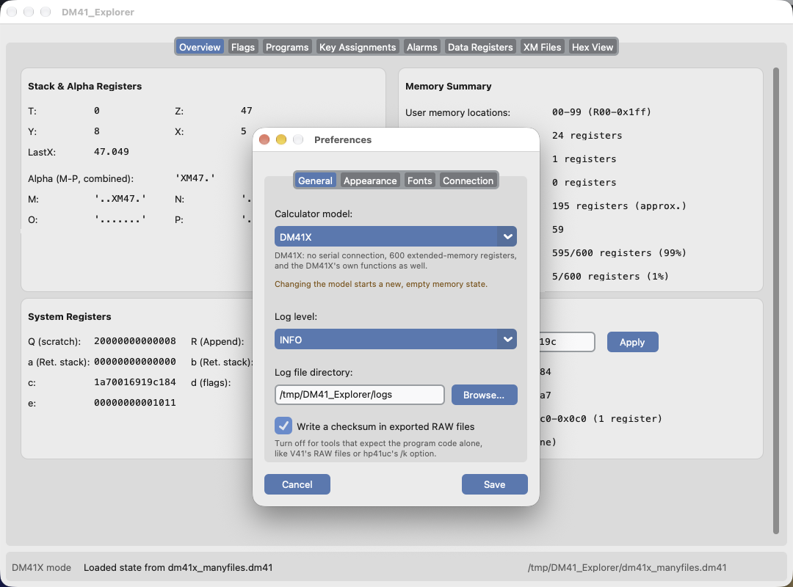

- **Calculator model:** DM41L or DM41X; see [Calculator
  model](#calculator-model). Changing it starts a new, empty memory state, so
  DM41_Explorer asks you to confirm first. If you decline, the other settings
  are still saved.
- **Log level** and **Log file directory:** how much DM41_Explorer records in
  its log file, `dm41_explorer.log`, and where that file goes. Attach the log
  to a bug report. The default level, INFO, is enough for most problems;
  DEBUG records much more.
- **Write a checksum in exported RAW files:** on by default. Turn it off for
  tools that expect the program bytes alone, such as V41 or hp41uc's `/k`
  option.

### Appearance

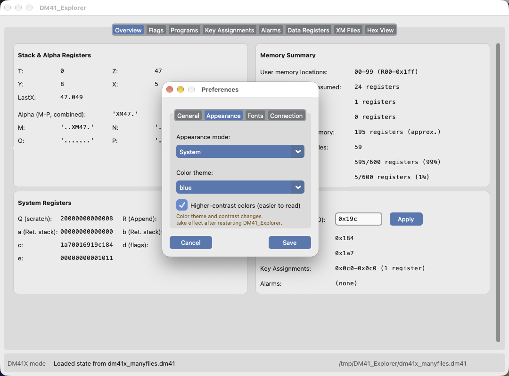

- **Appearance mode:** System (follows your computer's light or dark
  setting), Light, or Dark.
- **Color theme:** the color of buttons and other controls: blue, dark-blue,
  gold, or green.
- **Higher-contrast colors:** on by default; adjusts the theme's colors so
  text is easier to read.

The appearance mode changes as soon as you save. The color theme and contrast
take effect the next time you start DM41_Explorer.

### Fonts

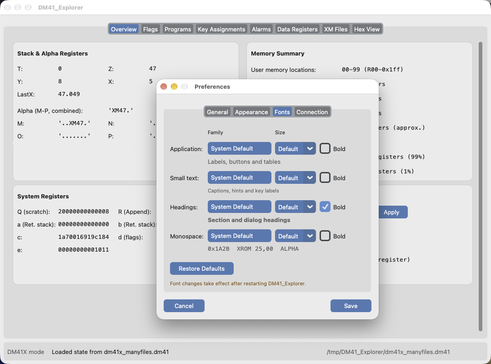

DM41_Explorer uses four fonts: **Application** for labels, buttons, and
tables; **Small text** for captions and hints; **Headings**; and **Monospace**
for addresses, register contents, and other fixed-width text. For each one you
can choose a family (click the button to pick from a list; Monospace lists
only fixed-width fonts), a size, and bold. The sample under each row shows how
it will look. **System Default** and **Default** use your platform's usual
font and size, and **Restore Defaults** sets every row back to them. Font
changes take effect the next time you start DM41_Explorer.

### Connection

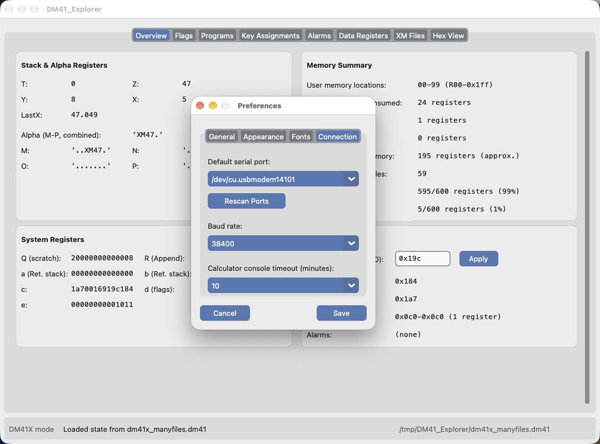

These settings matter only for a DM41L connected over USB serial.

- **Default serial port:** the port Connect offers first. DM41_Explorer also
  remembers the last port that connected successfully. **Rescan Ports**
  refreshes the list after you plug the calculator in.
- **Baud rate:** leave this at 38400, the only speed the DM41L supports.
- **Calculator console timeout (minutes):** DM41_Explorer sets the
  calculator's serial console timeout to this (its `ct` command) each time it
  connects.

## Calculator model

DM41_Explorer works as one model at a time, chosen in Preferences → General
→ Calculator model and shown in the status bar. New installations start in
**DM41X mode**, the more common device.

| | DM41L mode | DM41X mode |
| --- | --- | --- |
| Serial connection | Yes | No — a DM41X has no serial console |
| Extended memory | 362 registers | 600 registers |
| Functions | the HP-41CX set | that, plus the DM41X’s own |
| Plug-in modules | none — it can’t load modules | any, named by the [XROM libraries](#xrom-libraries) you turn on |
| Key Assignments tab | the DM41L keyboard | the classic HP-41 keyboard |
| New files default to | `.dm41` | `.d41` |

Two things follow from this:

- **Changing the model starts a new, empty memory state.** To move programs
  or data from one model to the other, export them before switching and
  import them afterwards.
- **Opening a state that is too large for a DM41L**, while in DM41L mode,
  offers to switch to DM41X mode so it can be opened. Accepting applies for
  that session only and does not change the saved setting; the status bar
  then reads “DM41X mode (this session)”. Declining leaves everything as it
  was.

A state file itself says nothing about which model wrote it — a `.dm41` and a
`.d41` are the same format — so the mode, not the file, decides how one is
read.

## Documentation

There are many markdown files in the
[`docs`](https://github.com/mwheinz/DM41_Explorer/tree/main/docs) directory.
These represent my research notes from developing this project. Hopefully
they will be useful to you if you are curious about the internals of the HP41
and the DM41L/X emulator.
[`docs/xrom_libraries.md`](docs/xrom_libraries.md) is the user's guide to XROM
libraries, including the file format for writing your own.

Most of my notes are derived from 40 year old memories and classic HP41 texts
like *Synthetic Programming* by Jonathan Wickes, supplemented by
reverse-engineering DM41L memory states. Other sources include *A Programmer's
Handbook* by Poul Kaarup, *HP-41 Advanced Programming Tips* by Alan McCornack &
Keith Jarett, and *Synthetic Programming Made Easy* by Keith Jarett. Other
information came from conducting experiments and studying the resulting memory
states.

## Running from source

```sh
git clone https://github.com/mwheinz/DM41_Explorer.git
cd DM41_Explorer
python3 -m venv venv
source venv/bin/activate   # on Windows: venv\Scripts\activate
pip install -r requirements.txt
cd src
python3 -m gui.app
```

On Linux, `tkinter` isn't always bundled with Python — if the app fails to
import `tkinter`, install it separately first (e.g. `sudo apt install
python3-tk` on Debian/Ubuntu).

To also run the test suite or build a standalone binary, install the
development requirements instead of just the runtime ones:

```sh
pip install -r requirements-dev.txt
```

## Building the standalone application

A PyInstaller spec (`src/dm41explorer.spec`) and build script (`src/build.sh`)
are included, producing a self-contained app — a macOS `.app` bundle
(with `.dm41` file association) on macOS, and a onedir bundle on Linux and
Windows.

```sh
cd src
./build.sh
```

Output lands in `src/dist/`. `build.sh` is a shell script — on Windows,
run it from Git Bash (installed alongside [Git for
Windows](https://git-scm.com/download/win)) or WSL, or invoke PyInstaller
directly with `pyinstaller dm41explorer.spec` after generating `dm41version.py`
yourself (see the comment at the top of `build.sh`).

On Linux and Windows, the executable needs the `_internal/` folder that's
built alongside it — don't separate them, or move the exe without also
moving `_internal/`. A `README.txt` explaining this ships in that same
output folder (and in every Linux and Windows release download) for anyone
unzipping it without this context. The Linux build also includes `MyIcon.png`, ready
to use as a `.desktop` file's `Icon=` entry if you set one up yourself.

The built binaries aren't code-signed (this is an independently-developed
hobby project without an Apple or Microsoft developer account), so:

- **macOS** will refuse to open it as coming from an "unidentified
  developer" — right-click (or Control-click) the app and choose Open,
  then confirm once, instead of double-clicking it.
- **Windows** will show a SmartScreen warning — click "More info", then
  "Run anyway".

Building and running from source, as above, doesn't trigger either of
these.

## Contributing

Bug reports, feature requests, and pull requests are welcome — see
[`CONTRIBUTING.md`](https://github.com/mwheinz/DM41_Explorer/blob/main/CONTRIBUTING.md) for how to get set up, run the tests, and
what makes a good bug report or PR.

## Running the tests

```sh
pip install -r requirements-dev.txt
pytest
```

## License

Copyright (C) 2026 Michael Heinz.

DM41_Explorer is free software: you can redistribute it and/or modify it
under the terms of the GNU General Public License, version 3, as published by
the Free Software Foundation. It is distributed in the hope that it will be
useful, but WITHOUT ANY WARRANTY; without even the implied warranty of
MERCHANTABILITY or FITNESS FOR A PARTICULAR PURPOSE. See the GNU General
Public License for more details.

The full text is in [`LICENSE`](LICENSE), and is also at
<https://www.gnu.org/licenses/gpl-3.0.html>.
