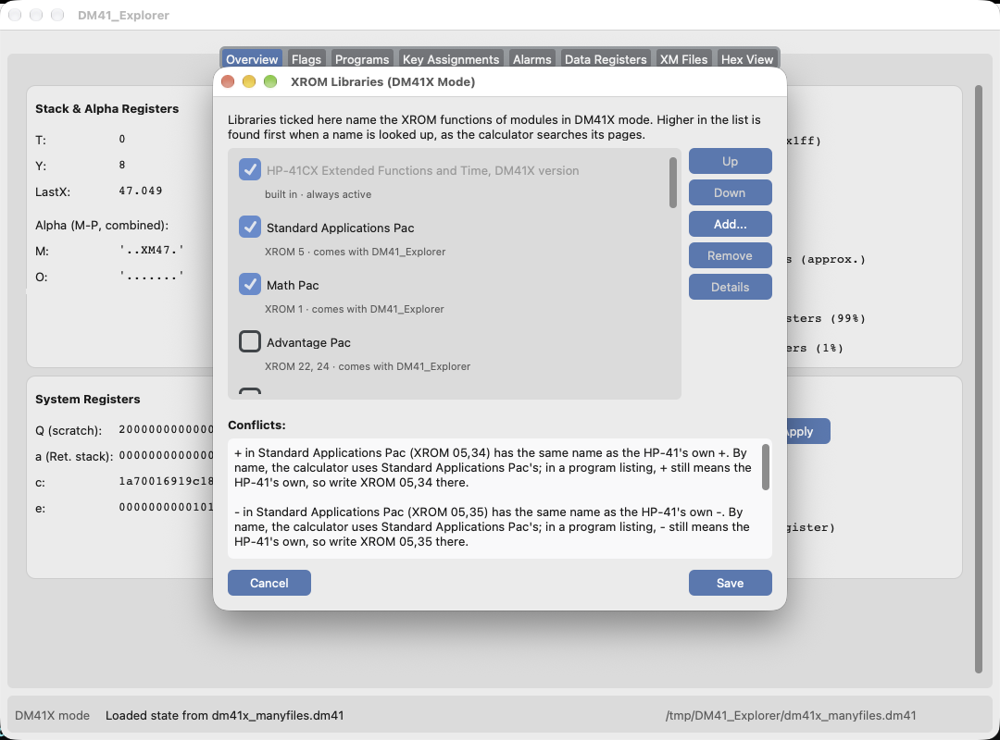

# XROM Libraries

An XROM instruction calls a function in a ROM module: built into the calculator, like the HP-41CX's Extended Functions, or plugged in, like the Math Pac. It is stored as two bytes that say only *which* function: `XROM mm,ff`, module `mm` (1–31) and function `ff` (0–63). The name is not stored. The calculator shows a name only if a module with that number is present.

DM41_Explorer gets those names from **XROM libraries**: one file per ROM, listing its module numbers and its functions' names. This page explains:
- [where the libraries come from](#the-libraries);
- [how to choose the active ones](#choosing-libraries);
- [how a name is found](#how-a-name-is-found);
- [what the conflict messages mean](#conflicts);
- [how to add your own](#adding-your-own), and [the file format](#the-file-format).

The design and the tests on real calculators behind it are in GitHub issues [#44](https://github.com/mwheinz/DM41_Explorer/issues/44) and [#52](https://github.com/mwheinz/DM41_Explorer/issues/52).

## The libraries

**Built in.** Each model has one library that is always active, because the ROMs are inside the calculator:

| Model | Library | Contents |
| --- | --- | --- |
| DM41L | `hp41cx` | The HP-41CX Extended Functions (XROM 25) and Time (XROM 26) ROMs. |
| DM41X | `dm41x-cx` | The DM41X's patched versions of those ROMs: the HP-41CX set plus X<I>Y (25,63), TRNG (26,36), the 16 `-DM 41X-` functions (26,38–26,53) and the ROMs' section headers. |

**Shipped with DM41_Explorer.** These are the 20 application pacs on the DM41X's disk, plus the Thermal Printer, which is preloaded in the DM41X's flash. The pac libraries were read from the `.mod` files themselves, and their numbers were checked against a real DM41X:

| XROM | Library | XROM | Library |
| --- | --- | --- | --- |
| 1 | Math Pac | 11 | Real Estate Pac |
| 2 | Stat Pac | 12 | Machine Design Pac |
| 3 | Surveying Pac | 13 | Thermal & Transport Science Pac |
| 4 | Financial Decisions Pac | 14 | Navigation Pac |
| 5 | Standard Applications Pac | 15, 16 | Petroleum Fluids Pac |
| 6 | Circuit Analysis Pac | 19 | Aviation, Clinical Lab, Securities |
| 7, 19 | Structural Analysis Pac | 20 (and 10) | PPC ROM |
| 8 | Stress Analysis Pac | 22, 24 | Advantage Pac |
| 9 | Home Management Pac | 29 | Thermal Printer |
| 10 | Games Pac | | |

Several pacs share an XROM number, as on the original HP-41, where only one of them could be plugged in at a time.

**Your own.** You can add any ROM you have as a `.mod` file or an hp41uc XROM list: see [Adding your own](#adding-your-own).

## Choosing libraries

**Tools → XROM Libraries…** opens the manager for the current mode (DM41L or DM41X).



- **The first row** is the mode's built-in library. It is always on.
- **Tick** a library to make it active. Its names then appear in the Key Assignments tab, in the key-assignment dialog and in the FOCAL Mnemonics Reference, and they can be used in program text you import.
- **Up and Down** set the order. A library higher in the list is found first by name, which stands in for the order of the calculator's ROM pages (see [below](#how-a-name-is-found)). On a DM41X you can't always choose the pages, since an 8K module takes a page pair, so set the order to match the calculator's Module ROM Map.
- **Add…** imports a library, and **Remove** deletes one of your own (the shipped ones can't be removed). **Details** lists a library's information and every function, by number.
- **The conflict panel** shows what the ticked libraries clash on, as it will be after you save.
- **Save** applies the changes at once. If two active libraries now share an XROM number, you are told once.

Each mode keeps its own arrangement. A DM41L can't load modules, so in DM41L mode a library only names XROMs that appear in programs and keys; the calculator itself still can't run them.

The arrangement is saved in the preferences file under `xrom_libraries`. A library that it names but that no longer exists is listed as "missing" until you remove it.

## How a name is found

Two different questions arise. **Which name does XROM `mm,ff` have?** That one is answered by number: the built-in library first, then the active libraries in order. The first one with that number names it, and if none has it, it shows as `XROM mm,ff`.

**Which function does a name mean?** Tests on a real DM41X showed that, when you `ASN` or `XEQ` a name, the calculator searches:
1. the built-in **Time ROM** (XROM 26);
2. the **plug-in modules**, in page order;
3. the built-in **Extended Functions ROM** (XROM 25);
4. the **mainframe** functions.

So with the Standard Applications Pac plugged in, `ASN "LOG"` assigns the pac's LOG, not the built-in one. Whether a function is MCODE or a FOCAL program makes no difference.

DM41_Explorer follows that order where you type a name **as you would on the calculator**: in the key-assignment dialog's Function tab. A **program listing** is different. There, a bare name keeps meaning the mainframe or built-in function, so an imported listing doesn't change meaning when you switch a pac on (hp41uc reads listings the same way). To get a module's function in a listing, write it explicitly:

| You write | It means |
| --- | --- |
| `LOG` | the mainframe LOG, in a listing; the first LOG in the order above, in the Function tab |
| `XROM 05,45` | XROM 05,45, whatever is active |
| `XROM "LOG"` | the first **XROM** function named LOG, in the order above; never the mainframe one |

Whichever way you name it, a key always stores the function's two bytes, as the calculator does. Exported listings write module functions as `XROM mm,ff ;NAME`, which means the same thing whatever libraries are active when the file is imported again.

**Section headers** (the `-EXT FCN 2X`, `MATH 1C` lines in CAT 2) are shown by name, for example on a key that holds XROM 25,00 (the DM41X's hidden `CRT?`). They can't be typed or picked, so assign one by its numbers on the XROM tab.

## Conflicts

| Message | Meaning |
| --- | --- |
| **Warning:** "Aviation Pac and Clinical Lab Pac both use XROM 19…" | Two active libraries use one module number. A calculator can run only one of them. Every XROM 19 instruction is named from the first library in the list, and the other library's functions at that number can't be reached at all. Untick one of them. |
| "SOLVE in Math Pac (XROM 01,09) is hidden by SOLVE in Advantage Pac (XROM 24,03)…" | Both functions are usable, but the name means the one found first. Reach the other one by number. |
| "The built-in SIZE? (XROM 25,44) is hidden by SIZE? in Real Estate Pac…" | By name you get the pac's SIZE?, as on the calculator, while in a listing SIZE? still means the built-in one. |
| "LOG in Standard Applications Pac (XROM 05,45) has the same name as the HP-41's own LOG…" | By name you get the pac's LOG; in a listing LOG still means the mainframe one. Write `XROM 05,45` or `XROM "LOG"` for the pac's. |

## Adding your own

**Add…** in the manager accepts three kinds of file:

- **A `.mod` file:** the module images the DM41X, V41 and i41CX load. The names are read from the ROM's own function table: the MCODE name stored before each entry point, or the global label a FOCAL program starts with. Nothing else is taken from the image. A function whose name can't be read is left out with a note, and can still be assigned by number.
- **An hp41uc XROM list (`.txt`):** one function per line, `NAME mm ff`, separated by spaces:

  ```
  ALENG 25 1
  ANUM 25 2
  ```

  The library is named after the file.
- **A library file (`.json`):** in [the format below](#the-file-format).

The file is converted, checked and copied to your library folder, so moving or deleting the original afterwards doesn't matter.
- **The folder:** `~/.dm41_explorer/xroms/`, next to the preferences file.
- **Ids:** a library's id comes from its file name. An id that a shipped library uses is never replaced; your library gets a new one, such as `math-2`. If one of your own libraries already has the id, you are asked whether to replace it or to add the new one separately.

To convert files in bulk without the app, `tools/make_xrom_library.py` uses the same code:

```bash
python3 tools/make_xrom_library.py MYROM.mod OTHER.mod -o out/
python3 tools/make_xrom_library.py LIST.txt --title "My ROM" -o out/
```

## The file format

A library is a UTF-8 JSON file named `<id>.json`:

```json
{
  "format": "dm41-xrom-library",
  "format_version": 1,
  "id": "math",
  "title": "Math Pac",
  "version": "C",
  "part_number": "5061-5261",
  "author": "Hewlett-Packard",
  "source": "FAT of MATH.MOD",
  "builtin_on": [],
  "modules": [
    {
      "xrom": 1,
      "page_id": "MA1C",
      "functions": [
        {"fn": 0, "name": "MATH 1C", "type": "mcode", "header": true},
        {"fn": 1, "name": "MATRIX", "type": "focal"},
        {"fn": 16, "name": "Z↑N", "type": "focal"}
      ]
    }
  ]
}
```

| Field | Required | Meaning |
| --- | --- | --- |
| `format`, `format_version` | yes | Always `"dm41-xrom-library"` and `1`. A file from a newer version of DM41_Explorer is refused rather than half-read. |
| `id` | yes | Lower-case letters and digits, joined by `-`. Unique among all libraries; the preferences refer to it. |
| `title` | yes | The name shown in the manager and in messages. |
| `version`, `part_number`, `author`, `source` | no | Shown in Details. |
| `builtin_on` | no | The models with this ROM built in. Only the shipped built-in libraries use it; a library you add is always a plug-in. |
| `modules[].xrom` | yes | The module number, 1–31. A library can have several (Advantage has 22 and 24), each listed once. |
| `modules[].page_id` | no | The ROM's ID, for information. |
| `functions[].fn` | yes | The function number, 0–63, each listed once per module. |
| `functions[].name` | yes | The name as the calculator displays it, in Unicode: Σ ≠ ↑ ∡ µ × as themselves, not their ASCII stand-ins. |
| `functions[].type` | no | `"mcode"` or `"focal"`, for information. |
| `functions[].header` | no | `true` for a CAT 2 section header: shown by name, never matched by name. |

Other fields are ignored, so a later version can add some.

A name's ASCII spelling, for export and typing, is worked out from its display name: Σ → S, ≠ → #, ↑ → ^. A character with no stand-in is written as its [trigraph](trigraphs.md), so `P∡V` exports as `P\<)V` and is read back the same way.
